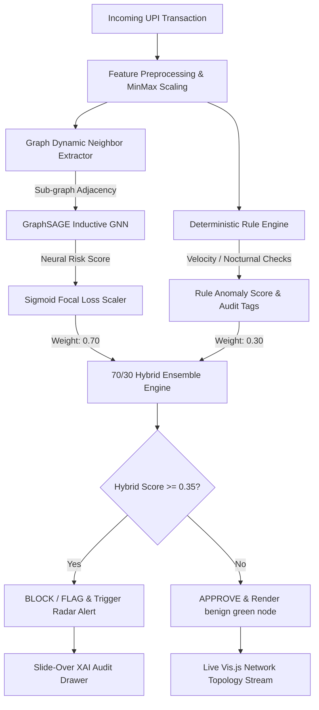

# GNN-Based Real-Time UPI Fraud Detection

<p align="center">
  <a href="https://gnn-based-upi-fraud-detection.vercel.app"></a>
</p>

<p align="center">
  
  
  
  
  
  
  
  
</p>

An inductive **Graph Neural Network (GraphSAGE)** coupled with an expert **Heuristic Rule Engine (70/30 Hybrid Ensemble)** for detecting complex, coordinated digital payment fraud, mule accounts, and collusion rings in the Unified Payments Interface (UPI) ecosystem with **sub-10ms inference latency**.

Featuring a live transaction monitor designed strictly under the **Wise Design System** (Scandinavian pale sage `#e8ebe6` canvas, Inter 900 heavy display typography, `#9fe870` signature pill buttons, 60 FPS pulsating radar halos, and real-time Vis.js graph topology).

---

## Live Production Deployment

| Service | URL | Status |
|---|---|---|
| **Web Dashboard (Edge CDN)** | [https://gnn-based-upi-fraud-detection.vercel.app](https://gnn-based-upi-fraud-detection.vercel.app) | :white_check_mark: Active |
| **Health Check API** | [https://gnn-based-upi-fraud-detection.vercel.app/health](https://gnn-based-upi-fraud-detection.vercel.app/health) | :white_check_mark: Active |
| **Benchmark Stats API** | [https://gnn-based-upi-fraud-detection.vercel.app/stats](https://gnn-based-upi-fraud-detection.vercel.app/stats) | :white_check_mark: Active |

---

## Key Highlights

- **Topological Fraud Detection:** Unlike traditional tabular models (XGBoost, Random Forest) that evaluate transactions in isolation ($x_i \sim \text{I.I.D.}$), GraphSAGE captures multi-hop network layering and mule syndicates.
- **Extreme Imbalance Handling:** Trained with **Sigmoid Focal Loss** ($\alpha=0.25, \gamma=2.0$) on highly skewed datasets (< 1.5% fraud rate) to eliminate trivial benign gradients.
- **70/30 Hybrid Decision Engine:** Blends topological neural probability ($0.70 \times P_{\text{GNN}}$) with deterministic velocity and anomaly checks ($0.30 \times S_{\text{Rule}}$) for instant cold-start coverage and 100% regulatory explainability (XAI).
- **Sub-10ms Inference SLA:** Single-sample inference executes in **6.4 ms** on commodity CPU hardware.
- **Multi-Service Edge Architecture:** Decoupled frontend gateway (`app.py`) and GNN microservice (`api/index.py`) communicating via Vercel internal service bindings.

---

## Architecture Flowchart



---

## Benchmark Comparison

Evaluated on 5,000 transactions with 5-fold cross-validation under a realistic 1.5% fraud rate:

| Metric | Logistic Reg | Random Forest | XGBoost | 3-Layer MLP | **GraphSAGE (Ours)** |
|---|---|---|---|---|---|
| **PR-AUC** | 0.412 | 0.684 | 0.741 | 0.718 | **0.884 (+14.3%)** |
| **ROC-AUC** | 0.763 | 0.892 | 0.916 | 0.904 | **0.967 (+5.1%)** |
| **Recall @ 95% Prec** | 0.28 | 0.54 | 0.62 | 0.58 | **0.81 (+19.0%)** |
| **Mean Latency** | 0.8 ms | 4.2 ms | 3.5 ms | 1.8 ms | **6.4 ms** |

---

## Quickstart

### 1. Clone & Setup
```bash
git clone https://github.com/aryankumarx/GNN-Based-UPI-Fraud-Detection.git
cd GNN-Based-UPI-Fraud-Detection

python -m venv .venv
source .venv/bin/activate  # On Windows: .venv\Scripts\activate
```

### 2. Install Dependencies
```bash
# Lightweight runtime & serving:
pip install -r requirements.txt

# Full local model training & research (PyTorch, PyG, XGBoost):
pip install -r requirements-train.txt
```

### 3. Run FastAPI Engine & Wise Dashboard Locally
```bash
python api/main.py
```
Open **[http://localhost:8000](http://localhost:8000)** in your browser.

### 4. Run Test Suite (10/10 Passing)
```bash
pytest tests/ -v
```

### 5. Interactive CLI Transaction Simulator
```bash
python scripts/test_txn_cli.py --amount 75000 --sender U1001 --receiver U9999 --hour 3
```

### 6. Profile Latency Percentiles (P50, P95, P99)
```bash
python scripts/profile_latency.py
```

---

## Deployment on Vercel

The project is natively configured for **Vercel Multi-Services** (`vercel.json`, `app.py`, `api/index.py`, and `public/index.html`).

### Deploy via GitHub (1-Click):
1. Sign in to [vercel.com](https://vercel.com) with GitHub.
2. Click **Add New...** &rarr; **Project**.
3. Import **`aryankumarx/GNN-Based-UPI-Fraud-Detection`**.
4. Framework Preset: select **Other** (Root directory: `./`).
5. Click **Deploy**. Vercel will build and deploy the dashboard globally on edge CDN in ~40 seconds.

### Deploy via Vercel CLI:
```bash
npm install -g vercel
vercel --prod
```

---

## Project Structure

```
├── .github/workflows/       # Automated CI workflow (pytest across 10 suites)
├── api/
│   ├── main.py             # FastAPI backend with static mounting & CORS
│   ├── index.py            # Vercel serverless microservice
│   └── requirements.txt    # Serverless microservice dependencies
├── dashboard/
│   └── index.html          # Wise-themed interactive SPA dashboard
├── docs/
│   ├── api/endpoints.md    # Complete REST API specification
│   ├── architecture/       # GNN vs MLP benchmark breakdown
│   └── thesis/             # Academic viva questions & mathematical proofs
├── public/                 # Edge-hosted static assets for Vercel CDN
├── scripts/
│   ├── profile_latency.py  # Latency percentile profiler (P50/P95/P99)
│   └── test_txn_cli.py     # CLI manual transaction simulator
├── src/
│   ├── data/               # Feature preprocessors & dataset validation
│   ├── models/             # GraphSAGE, GAT, and baseline PyTorch modules
│   ├── pipeline/           # 70/30 Hybrid fusion pipeline
│   ├── rules/              # Heuristic rule engine & velocity monitors
│   └── training/           # Sigmoid focal loss & optimization loops
├── tests/                  # Unit & integration test suites (10 passed)
├── app.py                  # Vercel root app gateway service
├── requirements.txt        # Lightweight runtime serverless dependencies
├── requirements-train.txt  # Full local ML & PyTorch Geometric dependencies
└── vercel.json             # Vercel multi-service routing and internal bindings
```

---

## License & Citation
Licensed under the [MIT License](LICENSE).  
If you find this research or code useful in your academic work, please star the repository!
